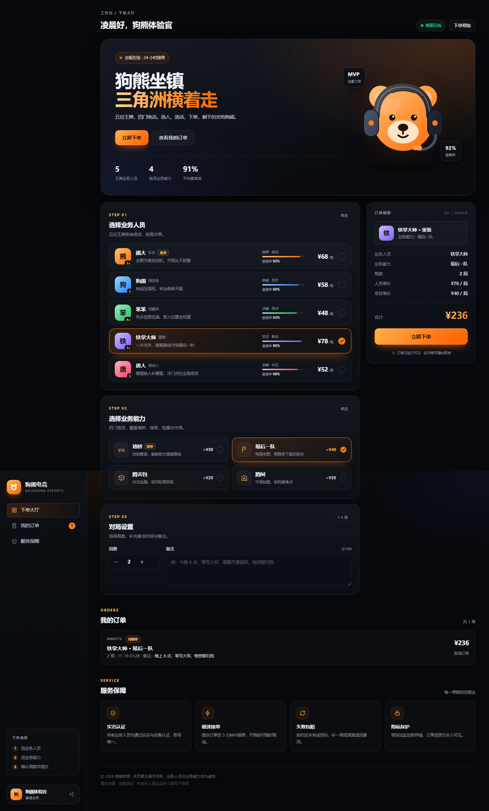
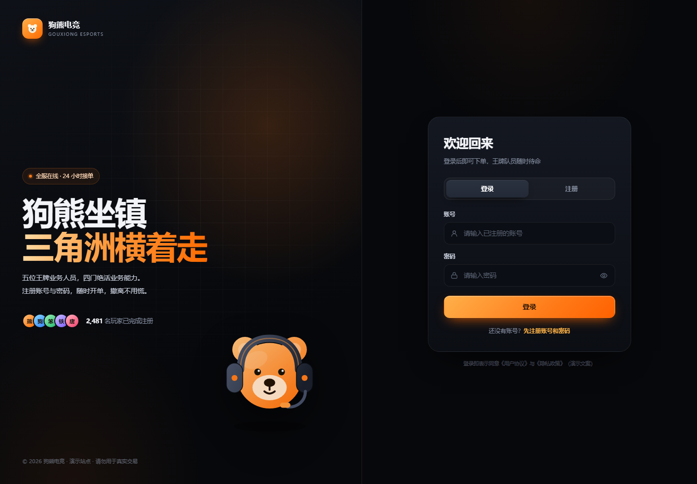

# 狗熊电竞

一个可直接运行的「三角洲陪玩下单」网站：先注册账号与密码，登录后选择业务人员、业务能力并下单。

- 业务人员：熊大、狗熊、笨笨、铁掌大师、唐人
- 业务能力：堵桥、最后一队、蹲丢包、蹲闸
- 登录前必须先注册；账号密码加盐哈希存储，会话走 HttpOnly Cookie

## 预览

桌面端（1440px）：



移动端（390px）：


登录 / 注册页：



## 运行

需要 Node.js 18+（无第三方依赖）：

```bash
cd xiongdian-esports
npm start
```

打开 <http://127.0.0.1:8090>。首次使用请点「注册」创建账号与密码，注册成功后会自动登录。

自定义端口：

```bash
PORT=8091 npm start
```

数据保存在 `data/db.json`（用户、会话、订单），删除该文件即可重置站点。

## 部署到 Render

项目已包含 `render.yaml`，可在 Render 上用 Blueprint 创建 Web Service。

1. 将整个 `xiongdian-esports` 目录推送到 GitHub / GitLab 仓库。
2. 登录 Render Dashboard → **New +** → **Blueprint**，选择该仓库，Render 会自动读取 `render.yaml`。
3. 点击 **Apply**，等待构建完成。
4. 访问 `https://<service-name>.onrender.com`。

也可以在 Render 手动创建 Web Service：

| 配置 | 值 |
| --- | --- |
| Runtime | Node |
| Build Command | `npm install` |
| Start Command | `npm start` |
| Health Check Path | `/api/health` |
| 环境变量 | `HOST=0.0.0.0`、`TRUST_PROXY=1` |

免费实例说明：

- 15 分钟无请求会休眠，下次访问需要冷启动。
- 文件系统是临时的，重新部署或重启后 `data/db.json` 会清空。
- 需要保留注册账号与订单：升级到付费实例并挂载磁盘到 `/var/data`，再设置 `XD_DATA_DIR=/var/data`（见 `render.yaml` 注释）。
- Render 自动提供 HTTPS，服务端会识别 `X-Forwarded-Proto` 并给会话 Cookie 加 `Secure`。

## 公网访问（Cloudflare Tunnel，可选）

使用 Cloudflare 快速隧道把本机 8090 端口暴露到公网，无需 Cloudflare 账号：

```powershell
# 若 tools\cloudflared.exe 不存在，先下载
New-Item -ItemType Directory -Force tools | Out-Null
Invoke-WebRequest `
  -Uri "https://github.com/cloudflare/cloudflared/releases/latest/download/cloudflared-windows-amd64.exe" `
  -OutFile "tools\cloudflared.exe"

# 建立隧道（http2 协议在受限网络下更稳）
tools\cloudflared.exe tunnel --url http://127.0.0.1:8090 --no-autoupdate --protocol http2
```

输出中的 `https://xxxx.trycloudflare.com` 就是公网地址，任何人可直接访问。快速隧道的域名在每次重启 cloudflared 后都会变化；需要固定域名时，请登录 Cloudflare 后创建命名隧道并绑定自己的域名。

服务端已适配反向代理：通过 `CF-Connecting-IP` / `X-Forwarded-For` 识别真实访客 IP（限流按访客计算），并在 `X-Forwarded-Proto: https` 时为会话 Cookie 加上 `Secure`。

## 测试

```bash
npm test
```

覆盖注册校验、重复注册、未注册账号登录、错误密码、下单、取消、鉴权、静态资源与路径穿越等。

## 目录

```
server.js           HTTP 服务、路由、静态资源、安全响应头
lib/catalog.js      业务人员 / 业务能力目录与计价
lib/auth.js         注册、登录、scrypt 密码哈希、会话
lib/orders.js       订单创建、查询、取消
lib/store.js        JSON 持久化（原子写入）
public/             前端页面（原生 HTML / CSS / JS，无构建）
tests/api.test.js   API 全流程测试
```

## 说明

本项目为演示用途，业务人员、业务能力、价格与宣传数据均为虚构，请勿用于真实交易。
